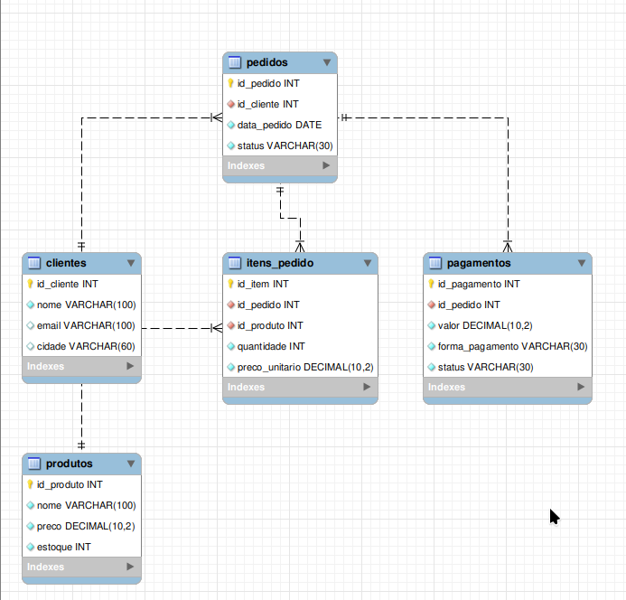

# Banco de dados de vendas com MySQL

Projeto de estudo com um servidor MySQL 8.4 executado em Docker. O diagrama
`schema.png` mostra o modelo de um sistema simples de vendas: clientes fazem
pedidos, os pedidos contêm produtos e podem ter pagamentos associados.

## Modelo do banco



As tabelas representadas no diagrama são:

- `clientes`: nome, e-mail e cidade de cada cliente.
- `produtos`: nome, preço e estoque disponível.
- `pedidos`: data e status de cada pedido, associado a um cliente.
- `itens_pedido`: produtos e quantidades de cada pedido, com o preço unitário.
- `pagamentos`: valor, forma e status de pagamento associado a um pedido.

`itens_pedido` relaciona pedidos e produtos: um pedido pode conter vários
produtos, e um produto pode aparecer em vários pedidos.

## O que este projeto inicia

O Docker Compose sobe o **servidor MySQL** e mantém os arquivos do banco na
pasta local `data/`, fora do container. O arquivo `config/my.cnf` configura
`utf8mb4`, conjunto de caracteres adequado para textos em português.

O diagrama documenta o modelo, mas **as tabelas não são criadas
automaticamente**: este projeto ainda não inclui um arquivo SQL de inicialização.

## Requisitos

- Docker
- Docker Compose (comando `docker compose`)

## Iniciar o MySQL

1. Ao clonar o projeto, crie seu arquivo local de configuração:

   ```bash
   cp .env.example .env
   ```

2. Edite `.env` e troque `MYSQL_ROOT_PASSWORD` por uma senha forte.

3. Inicie o servidor:

   ```bash
   docker compose up -d
   ```

4. Confira se está rodando:

   ```bash
   docker compose ps
   ```

O servidor fica disponível na porta `3306` do computador. Para abrir o cliente
MySQL dentro do container:

```bash
docker compose exec mysql mysql -uroot -p
```

Informe a senha definida em `.env`. Para criar o banco de estudo no cliente:

```sql
CREATE DATABASE loja;
USE loja;
```

Depois, crie as tabelas conforme o diagrama usando seus comandos SQL ou uma
ferramenta como MySQL Workbench.

## Parar e manter os dados

Para parar o container sem apagar os dados:

```bash
docker compose down
```

Os arquivos persistem em `data/` e serão reutilizados na próxima inicialização.
Não apague essa pasta se quiser manter o banco.

## Arquivos do projeto

- `docker-compose.yml`: servidor MySQL, porta, persistência e verificação de saúde.
- `config/my.cnf`: configuração do MySQL.
- `schema.png`: diagrama do modelo de vendas.
- `.env.example`: exemplo de configuração local.
- `data/`: arquivos do banco, mantidos fora do Git.

## Segurança

- Não publique `.env`, senhas ou o conteúdo de `data/`.
- `.gitignore` já exclui `.env` e `data/` do Git; `.env.example` e `schema.png`
  podem ser compartilhados.
- A porta `3306` é publicada no computador. Em redes não confiáveis, restrinja
  seu acesso pelo firewall.
